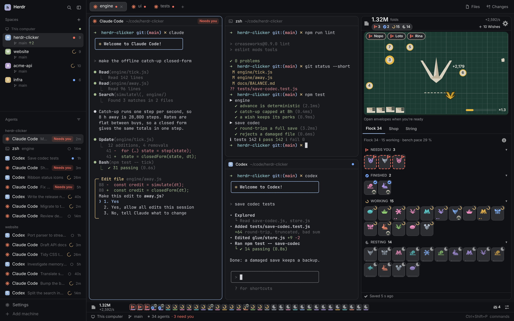
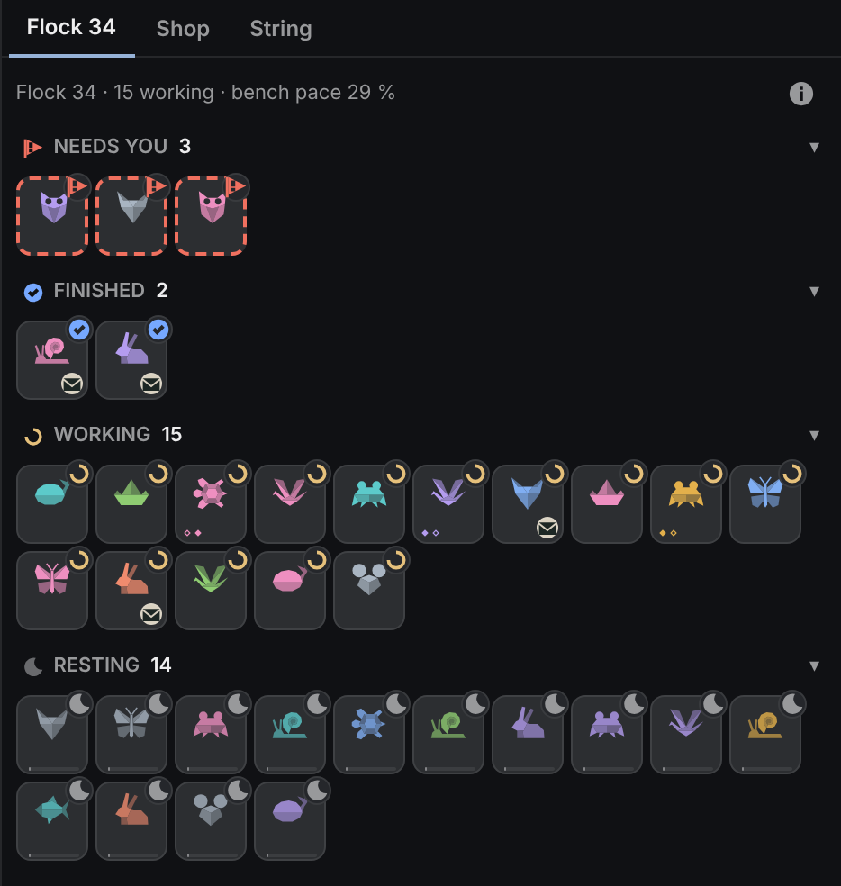
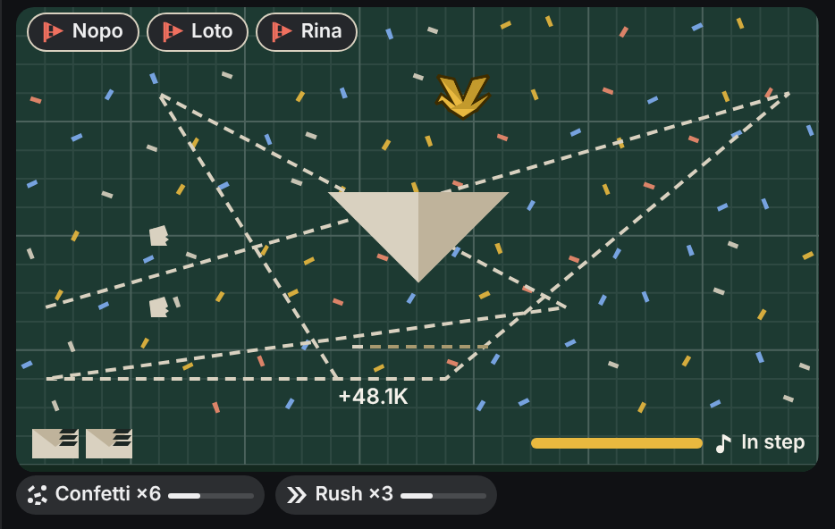
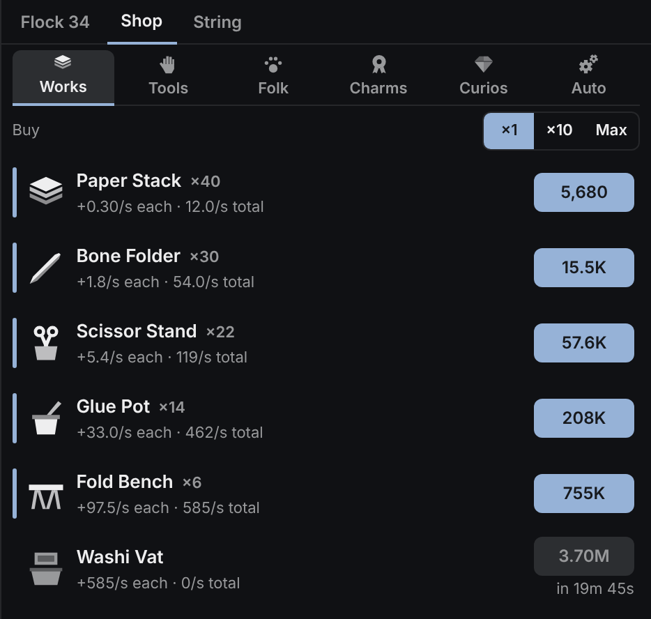
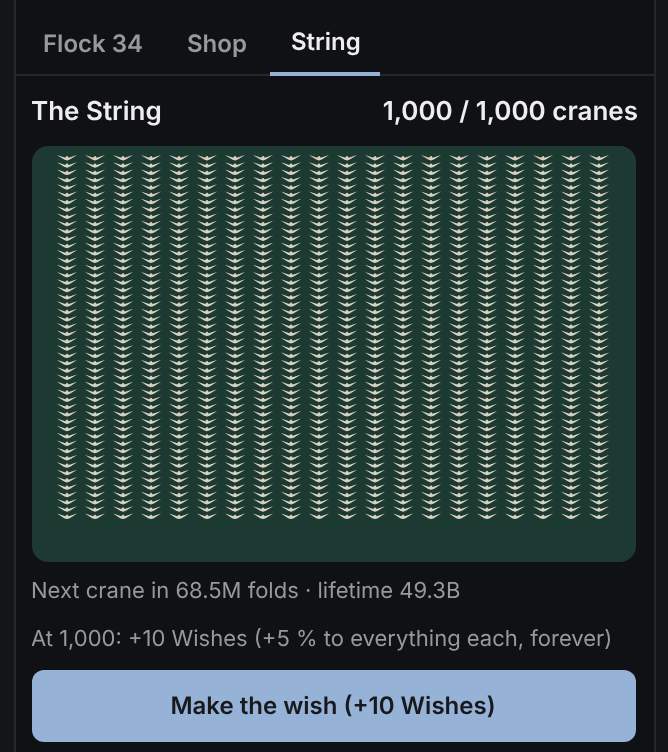
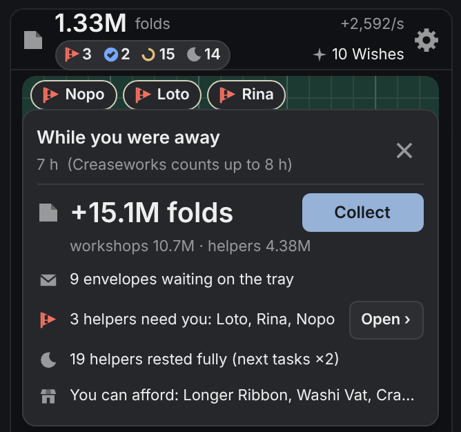
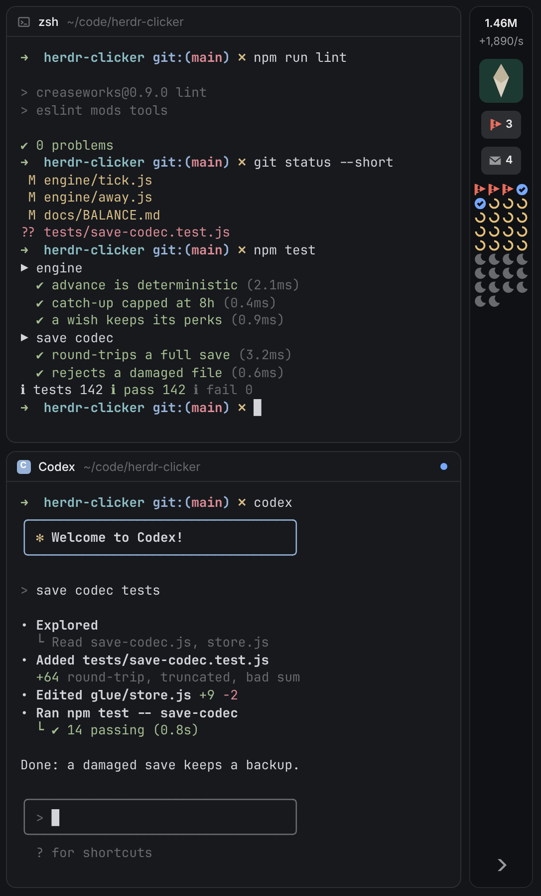
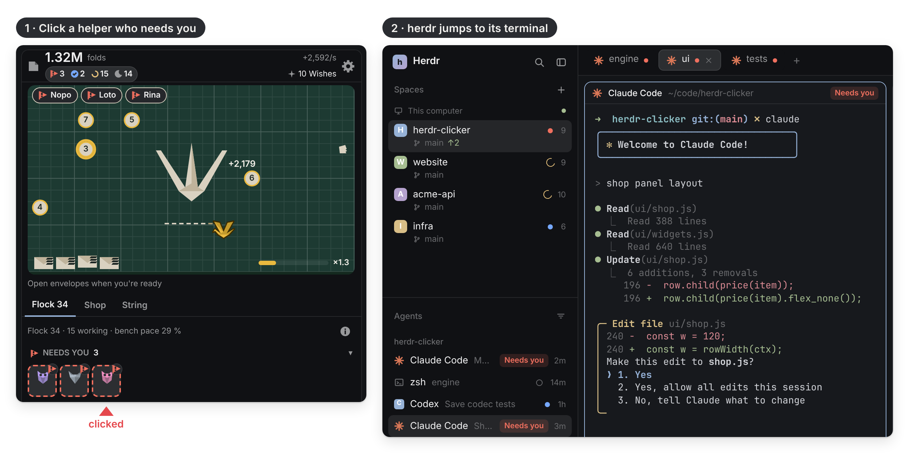
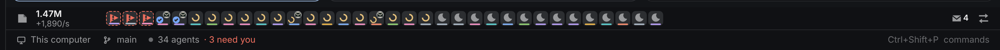
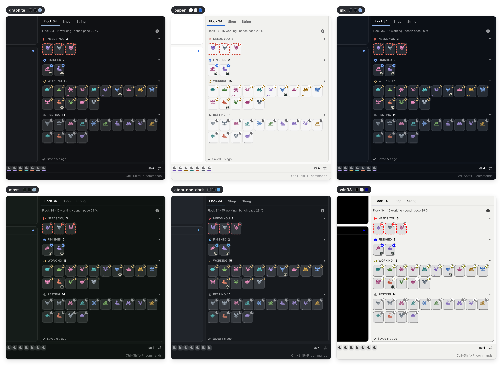

# Creaseworks

A paper workshop on the corner of your desk, built for [herdr](https://herdr.dev). You fold by hand, and your coding agents (paper folk) fold beside you. Click the paper, catch the gilded cranes and open the envelopes your agents send when they finish a task. When an agent is waiting for you, a pennant goes up, and clicking it takes you to that agent's pane. Your terminals stay where they are and work as usual.

<picture>
  <source media="(prefers-color-scheme: light)" srcset="docs/screenshots/hero-light.png">
  
</picture>

## A look around

| | |
|---|---|
|  |  |
| **Every agent is a helper.** Needs you, finished, working or resting, readable at a glance. | **Clicking stays fun.** Open a Rush and a Confetti, chain the nodes, catch the gilded crane. |
|  |  |
| **Spend your folds** on workshops, tools, folk, charms, curios and automations. | **String the Thousand.** Trade 1,000 cranes for Wishes, a permanent bonus. |
|  |  |
| **While you were away.** Helpers keep folding for up to 8 hours. | **Fold it to a rail** and your terminals get the room back. |



**Click a helper who needs you, and herdr jumps to its terminal.**



**The ribbon** under your terminals shows every helper's status, even with the panel hidden.



**Follows your herdr theme**, light or dark.

The herdr window around the game (sidebar, tabs, terminal transcripts) is drawn by the project's screenshot rig, not captured from herdr; the game panel and ribbon are real renders of the mod. See `docs/screenshots/CAPTIONS.md`; rebuild them with `node --import ./tools/node/register.mjs tools/shots/hero.mjs`.

## Install

Ask your herdr agent:

> Add the layout at https://github.com/tyevco/turbo-octo-robot

This adds `layouts/Creaseworks.json` and `mods/creaseworks/` to your herdr home and merges `keys.json` into your keys. Your agent asks before it replaces a key you already use. Then switch to it with `layout.switch {name:"Creaseworks"}`, or pick **Creaseworks** in Settings → Look. Your own layout stays as it was. To go back to it, run `layout.switch {name:"main"}` (or your layout's name) or pick it in Settings → Look. `ctrl-shift-l` does not go back: it cycles to the next layout in herdr's list (`main` first, then the rest by name), so from Creaseworks it usually opens `terminals`.

The mod needs no network access and runs no programs. It reads and writes only its own data folder, plus a shared save path if you choose to set one.

`RECIPE.md` describes how to rebuild it from scratch.

## Keys

These keys work only while the Creaseworks layout is shown (`layout:Creaseworks`):

| Key | Action | What it does |
|---|---|---|
| `ctrl-shift-g` | `creaseworks.fold` | Fold the panel to a 64 px rail, or unfold it |
| `ctrl-shift-y` | `creaseworks.answer` | Open the helper that has waited longest for you |
| `ctrl-shift-j` | `creaseworks.envelope` | Open the oldest envelope |

The command palette also has "Creaseworks: hide or show the panel" and entries for the three keys. herdr lists a mod's palette entries in every layout, but these work only while the Creaseworks layout is shown; anywhere else they show a "failed" toast and do nothing. Folding the paper has no key: you fold it with the mouse.

## Settings

Open them with the gear in the panel header.

- **Calm mode**: no motion and no floating numbers. Earnings stay the same.
- **Notifications**: off by default. When on, you get at most 3 a day and never a sound. Each of the three events has its own checkbox: string full, envelopes piling up, can't save. You never get a notification for agent status, because herdr already tells you about that.
- **Automations**: one switch for each automation you own (Mail Sorter, Thrifty Fox, Boost Keeper, Crease Helper).
- **Play**: Helpers gather, Crease nodes appear, Floating numbers.
- **Roster**: order (urgency groups or workspace order) and density.
- **Number style**: short (12.4K) or scientific.
- **Save**: the save path, Check save now, Restore backup…, and Share a save with another herdr home….
- **Reset game…**: asks you to confirm twice and keeps the old save.

## Where the save lives

```
<herdr app home>/data/creaseworks/save.json             the save
<herdr app home>/data/creaseworks/save.bak.json         backup (rotated at most every 5 minutes)
<herdr app home>/data/creaseworks/save.damaged-<n>.json damaged files kept aside (n = 1..5)
<herdr app home>/data/creaseworks/location.json         only when sharing a save
```

If `save.json` is damaged, the game loads the backup and keeps the damaged copy. A banner tells you when that happens, and save problems are always shown in the panel and the ribbon. Two herdr windows use two app homes. To play one game in both, use Settings → Save → "Share a save with another herdr home…" in the second window and point it at the first window's `save.json`.

## Development

You need Node 22 or later. Run `npm install` once. `npm run shots` also needs Playwright with Chromium, installed either locally or globally (it is not a dependency in `package.json`). The tools are development-only: they do not run herdr. Instead, they use a Node mock of herdr and gpui, plus a QuickJS-ng harness.

```
npm test               unit and integration tests (engine, glue, UI, layout, keys, art)
npm run test:frozen    the same tests with the sandbox's frozen prototypes
npm run test:qjs       loads the real mod in QuickJS-ng with herdr's time budgets
npm run sim -- --assert   pacing simulator; checks the targets in docs/BALANCE.md
npm run shots          Playwright screenshots of every view -> tools/out/shots/*.png
                       (e.g. npm run shots -- --themes graphite --no-vision)
npm run check          test + test:qjs + sim --assert
```

The design docs are in `docs/`: `DESIGN.md` (game spec), `BALANCE.md` (pacing targets) and `ARCHITECTURE.md` (code contract).

The herdr share package is `layouts/`, `mods/creaseworks/`, `keys.json`, `RECIPE.md` and `preview.png`. Everything else is tooling.

## Licence

MIT. Copyright (c) 2026 Tyler Coles. See [LICENSE](LICENSE).

Some development-only reference files are herdr's, under the Apache License 2.0 (text in [LICENSES/Apache-2.0.txt](LICENSES/Apache-2.0.txt)): `tools/layout/main.json`, `tools/layout/herdr-defaults.json`, `tools/mock/themes.json` and the herdr tables and ports in `tools/`. `layouts/Creaseworks.json` is adapted from herdr's `main.json`. [THIRD-PARTY-NOTICES.md](THIRD-PARTY-NOTICES.md) lists each file and what was changed.
