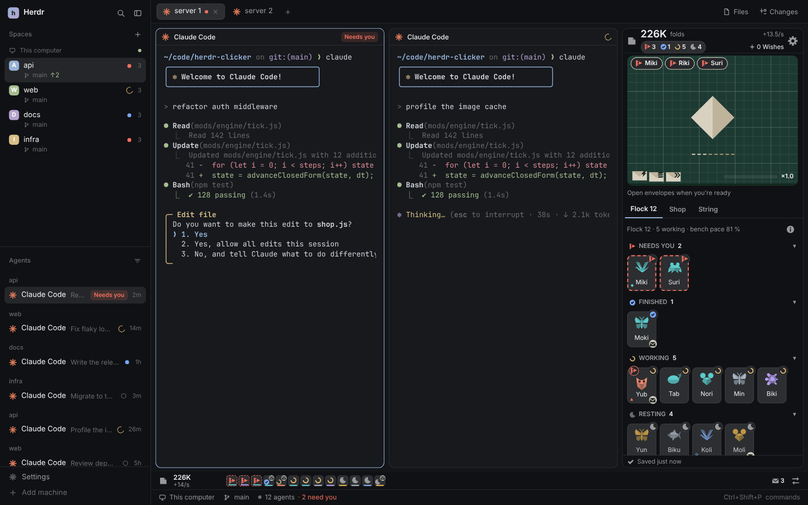

# Creaseworks

Herdr's usual main window, with a small paper workshop added on the right and a thin status ribbon above the status bar. The right panel holds a green cutting mat with a square of paper in the middle. Each click folds the paper, and every eighth fold finishes a little figure. Every coding agent in the window becomes one of the "paper folk", a helper that folds alongside you. Working agents fold on their own. A finished task arrives as a sealed envelope you can open. An agent waiting for input raises a pennant, and clicking the pennant opens that agent's pane. Resting agents lie flat and store up a boost for their next task. Folds buy workshops, tools, folk care, charms, curios and automations. After about three days of open time the string of cranes reaches 1,000, and you can trade it for Wishes, which are permanent. The terminals keep their usual place and stay fully usable.



## What you see

Left to right, then top to bottom. Sizes are logical px before zoom.

- **Sidebar (268 px, `chrome`)**: exactly the shipped `main` sidebar: brand (46), spaces and agents lists (weight 1 each, min 90), footer (69).
- **Work column** (`canvas`):
  - **Tabs bar (42)**: the shipped `tabs` mod.
  - **Work body** (a row with padding 8 and gap 8):
    - **Terminal panes** (`main`, weight 1, min 80 px): the shipped tab block with 10 px rounded pane frames and a 30 px pane header.
    - **Creaseworks panel** (`cw-panel`, weight 0.39, min 64, no max, radius 10, 1 px `border`, `chrome` background), right of the terminals. It shares the row with them by weight: 226 px at 1100×700, 322 at 1440×900, 456 at 1920×1080 and 636 at 2560×1440. From top to bottom:
      - **Header (44)**: fold count (18/600), rate per second (11, muted), a counts chip (`▲2 ✓1 ●5 ◗14`), Wishes, and a gear.
      - **Save banner (28)**: shown only when there is a save problem.
      - **Mat (the panel width minus 16, 232 tall; laid out on a 304×232 grid)**: a green cutting mat (`#2f6a55` light / `#1d3a32` dark) with a 16/64 px grid. The 112×112 Sheet (`#fbf7ee` / `#d9d1c0`) sits in the middle and steps through eight fold pictures (square, triangle, kite, square base, bird base, narrow, wings, crane), with 8 fold ticks under it. A top band shows needs-you chips, or the shelf of the last 12 figures when nobody is waiting. A bottom band shows the envelope tray (up to 6 envelopes, then `+n`) and the streak meter. Numbered crease nodes, scraps, the daily Fresh Ream, the gilded crane (`#f0c24b`), the Paper Boat and fold pieces appear on free slots of the mat. With the Crease Field curio, every 5th chain is instead a crease field: nine dots in a 3 × 3 grid on the Sheet itself.
      - **Boost bar (26)**: one chip with a countdown bar per running boost (Ridge's steady charge, and a Coil waiting for Rush or Confetti to end, are static chips with no countdown); with none, a muted hint, which names the next diagram to find while a crease field is up.
      - **Tabs (32)**: Flock, Shop, String and Book (after Crease Field is first bought; at Narrow width Book is its icon). Settings opens from the gear.
      - **Content**: a scrolling area for the current tab.
      - **Footer (22)**: a save glyph with "Saved 12 s ago", plus In step and Calm chips.
    - **Files / Changes panel** (hidden until opened, weight 0.66, min 160, no max): the shipped panel, last in the row. Open, it takes 257 px at 1100×700 and 367 at 1440×900, and the game panel narrows to 152 and 217.
  - **Ribbon** (`cw-ribbon`, 30 px, `chrome`, full work width, always shown). From left to right: the fold count and rate (118 px). Then one status mark per helper, never capped: 20×20 chips with a 2 px identity-colour bar while they fit, then two rows of 12 px pips, then tallies for working and resting helpers only beyond 82 helpers at 1100 px or 130 at 1440 px. Then the envelope count, a mini Sheet (shown while the panel is folded or hidden) and the fold button.
  - **Status bar (28)**: the shipped `workspace-status`.
- **Rail** (the panel folded to 64 px): from top to bottom, the count, a 44 px mini Sheet, a needs-you button, an envelope button, a pip grid with one mark per helper (4 columns at a 14 px pitch), the gilded crane while one is live, and an unfold chevron.
- **Panel widths**: below 200 px it draws the rail: folded (64 px), or unfolded but squeezed by the window (for example 152 px at 1100×700 with Files open). An unfolded but squeezed rail shows a fold button instead of the unfold chevron (folded or not comes from the layout's weight, not a width). Asking it for the full panel (a ribbon mark, tally or chip) restores the remembered width when a drag made it narrow; when the window itself is too narrow it flashes "Too narrow: …" (on a rail under 120 px just "Too narrow", with a ring on the chevron). From 200 to 279 px it is narrow (icon-only shop, dense tiles, a 184 px tall mat). From 280 to 399 px it is standard (232 px mat). At 400 px and over it is wide (260 px mat, more Flock columns). The mat is always the panel width minus 16. A panel shorter than 640 px uses the 184 px mat with a 96 px Sheet.
- **Type and colour**: the text is the person's UI font, at 11 px or larger everywhere. UI and status colours come from the person's theme (`chrome`, `raised`, `popover`, `border`, `muted`, `accent`, `working`, `blocked`, `done`, `idle`). Scene colours come from one fixed palette with a light and a dark set. Helper identity uses 8 hues (vermilion `#b8432a`, saffron `#946000`, leaf `#3b7330`, teal `#1d7373`, sky `#2b62b0`, violet `#6a4cb0`, plum `#9c3a72` and slate `#4c5a68` in light themes; lighter versions in dark themes) on 12 animal silhouettes: crane, frog, fox, koi, rabbit, turtle, butterfly, whale, owl, boat, mouse and snail.

## How it behaves

**Agent statuses.** Every agent herdr shows (from `agents()` and `terminals()`) is a saved helper. There is no cap and no daily limit. Each status has its own shape and a second cue that does not rely on colour:

| herdr status | In game | Shape | Other cue | Motion |
|---|---|---|---|---|
| `working` | Working: folds for you at an upgradable rate | 270° arc | "Working" group | Spins for 20 s after it starts working (at most 4 at once) and while you are In step |
| `blocked` or `error` | Needs you: stops helping | Pennant with a "!" | Dashed tile border, first group, a chip on the mat, ▲ in the counts chip | Pulses for 10 s, then stays still |
| `done` | Finished | Check in a circle | "Finished" group, ✓ in the counts chip | None |
| `idle` | Resting: charges a boost for its next task (×2 at a full charge, ×3 with Warm Hands) | Crescent | Rest bar, 0.8 opacity | None |
| Sub-agent | Fledgling: adds up to +25/50/75 % each (up to 4) to its parent, and keeps gathering for it while the parent rests, finishes or waits | Small diamond (hollow while resting) or triangle pip on the parent tile | Sits on the parent tile | None |
| Agent gone | Moves to the Album and keeps its history (after 10,000 newer ones it joins a monthly "1,204 helpers" archive row, still counted) | List row | Album section | None |

A status colour that falls below 3:1 on its surface falls back to `muted`, then to `foreground`. The pace drops off as more agents work at once ("bench pace"), but every working agent still adds folds.

**Clicks.**
- **Sheet**: one fold per click, at most 12.5 credited hits a second. Clicking in rhythm builds a streak of up to ×1.5 (×3 with upgrades). A streak of 25 is **In step**, which makes every working helper fold ×1.5. Hits made while In step bank **afterglow**, up to 20 minutes, which keeps helpers at ×1.25 while you code.
- **Crease nodes**: a chain of 3, 5 or 7 numbered nodes. Clicking them in order pays extra. A wrong order tears the chain, with no penalty.
- **Crease fields and the Pattern book** (after the Crease Field curio, 5e6, which needs Grand Crease): every 5th chain arrives as nine dots on the Sheet. Join neighbouring dots (diagonals count; never start on the centre), then click the last dot again to set, or end on the first to close; any turn, mirror or direction counts, and a trace still under way sets by itself when the field's 16 s run out. Every dot click is also a Sheet fold. A shape that is one of nine diagrams (Ridge, Gull, Napkin, Lozenge, Stair, Sail, Switchback, Hem, Coil) pays what the chain it replaced would have, the same for every diagram, plus a one-off bonus the first time; anything else is a loose crease that pays nothing more and clears for another try. A match fills a page of the Book tab (found at 1 trace, learned at 4, mastered at 12) and may leave a fold piece on the mat: click it for one small effect (a pause of up to 4 s that keeps your rhythm, a crane up to 20 s sooner, 90 s of afterglow, a Sheet click that finishes the paper, a rhythm meter 15 % fuller, longer-lived new scraps and cranes, a chain within 2 s, another field, hand hits ×2 for 10 s, which wait for any Rush or Confetti to end), after which that diagram's effect rests for 3 active minutes. Nothing is timed but the field's life, and the Crease Helper never traces.
- **Scraps, Fresh Ream** (once a day), **gilded crane** (Crane's Gift, which pays more the longer your rhythm and the more folk at work; Confetti; or Flock Song) and **Paper Boat** (Tailwind, after the Harbour Ribbon curio): click them before they leave. They spawn only while you are actively playing, so nothing is missed while you code.
- **Envelopes**: one per helper. Repeat finishes stack on it, up to ×9. Each agent earns units from a small budget that refills one unit every 12 minutes (at most one waiting): a finish takes what has built up, so many short turns earn about what a few long ones do, and an agent's sub-agents share one half-size budget however many of them there are. The seal shows the type before you open it: Bundle (folds, never less than 75 hand hits' worth), Rush (hand ×3), Confetti (hand ×6) or Chorus (helpers ×2: open it while your helpers work). Opening is your choice: click the tray, a tile marker or the ribbon's ✉, or press `ctrl-shift-j`.
- **Needs-you cue** (tile, mat chip, ribbon pip, rail button, ▲, or `ctrl-shift-y`): runs `pane.focus` for an agent that has a pane, or `terminal.peek` for a sub-agent without one. If the agent has gone, it shows "That agent has gone" instead.
- **Ribbon marks**: a needs-you or finished mark opens the pane. Any other mark unfolds the panel with that helper selected. Hovering shows the name, agent, place, status and how long.
- **Shop**: Works, Tools, Folk, Charms, Curios and Auto. Works can buy ×1, ×10 or Max. Each row shows the time until you can afford it, and a diamond marks the best buy.
- **String tab**: 20 strands of 50 cranes. At 1,000 cranes, **Make the wish** gives 10 Wishes (+5 % to everything for each one, kept forever). You confirm on a card whose button stays disabled for 1.5 s. A wish resets folds, workshops and upgrades (Crease Field too). It keeps helpers, Wishes, perks, timed boost envelopes, settings, switches and the Pattern book.

**Keys** (`layout:Creaseworks` only):

| Chord | Action | Does |
|---|---|---|
| `ctrl-shift-g` | `creaseworks.fold` | Folds the panel to the 64 px rail, or unfolds it to its last share of the row (default weight 0.39, about 320 px at 1440×900). Shows the panel first if it is hidden |
| `ctrl-shift-y` | `creaseworks.answer` | Opens the helper that has waited longest. Repeat presses cycle through them |
| `ctrl-shift-j` | `creaseworks.envelope` | Opens the oldest envelope |

The palette also has "Creaseworks: hide or show the panel" (`layout.toggle {id:"cw-panel"}`), next to entries for the three commands above. They work only while the Creaseworks layout is shown (see Watch out).

**Away.** Up to 8 hours of folds accrue while herdr is closed or the machine sleeps. The rate is 25 %, raised to 35 % or 45 % by upgrades. On return, a non-blocking "While you were away" card shows the time, folds, envelopes, who needs you, who rested and what you can now afford. One **Collect** click banks the folds, or they bank themselves after 10 minutes. A hidden window is not away: it keeps ticking every 5 s.

**Saving.** A save runs 2 s after a purchase or setting change, every 15 s while something changed, and when the mod closes. A problem shows on the ribbon chip, the rail glyph, the footer glyph and a banner (`recovered`, `fresh`, `conflict`, `merged`, `error`, `newer` or `clock`). Saving a mod file hot-reloads it, and the running game carries on without rolling back.

**Settings** (gear): Calm mode, Notifications (off by default; at most 3 a day; never sound), a switch for each automation you own, Play (Helpers gather, Crease nodes appear, Floating numbers), Roster (order and density), Number style, Save (path, Check save now, Restore backup…, Share a save with another herdr home…) and Reset game….

**What moves.** Nothing moves at rest. Animation runs only for a short time after an event: the needs-you pulse, new-work spins, the crane's glide and bob, the boat, Confetti stripes, an envelope landing, the first-run hint and floating "+N" numbers. Calm mode removes all of it and keeps every earning the same.

## Built from

**Layout** `layouts/Creaseworks.json`, written by `tools/layout/build.mjs` from the shipped `main.json`: every id and root field kept (`titlebar:"none"`, `traffic_lights:[12,16]`, `background:"canvas"`, `terminal_padding:[14,12]`). It adds `"preview": "mods/creaseworks/art/layout-preview.png"` and `"min": 80` on `main`, sizes the Files column `panel` by `{"weight": 0.66}` instead of `{"px": 368}`, lowers its min from 280 to 160 (at zoom 1.5 a 280 min would hold 420 px of a 1100 px window and leave the terminals 1 to 2 columns), drops its max of 900 (a capped weight node leaves an empty strip, see Watch out), and adds two blocks:

```
root (row)
├─ sidebar (column 268, min 44, max 480): brand · sidebar-lists{spaces, agents} · sidebar-footer
└─ work (column, resizable:false)
   ├─ tabs (42)                                   mod tabs
   ├─ work-body (row, padding 8, gap 8)
   │  ├─ main (tab:active, pane frame, min 80)
   │  ├─ cw-panel (weight 0.39, min 64, no max, radius 10, border, chrome)   mod creaseworks {role:"panel"}
   │  └─ panel (hidden, weight 0.66, min 160, no max) > panel-body (stack) > files · changes
   ├─ cw-ribbon (px 30, chrome)                   mod creaseworks {role:"ribbon"}
   └─ status (28)                                 mod workspace-status
```

The layout uses theme token names only. It sets no `theme` or `colors`.

**Shipped mods used**: `workspace-chrome`, `spaces`, `agents`, `tabs`, `pane`, `files`, `changes`, `workspace-status`.

**Mod** `mods/creaseworks/`:
- `mod.json`: `{"place":"none","title":"Creaseworks","palette":[…4 entries…]}`.
- `main.js`: the View class. It renders the ribbon or the panel by `props().role`; the panel draws the rail below 200 px (`ui/panel.js` `FULL_BELOW`).
- `engine/`: pure and deterministic. It has no herdr, no gpui, no `Date.now` and no `Math.random`. It uses a seeded mulberry32 with keyed draws, and its actions carry `(writer, seq)` for idempotent merges.
- `glue/`: the only files that import `herdr`.
- `ui/`: gpui-kit element builders.
- `art/`: 139 SVG files, 138 single-colour (`fill="#000"`, tinted through `svg()`; among them the nine fold pieces' base and shade layers and the Book tab's icon) plus `notify-icon.svg` (the one full-colour file), and `layout-preview.png` (216×124).

**herdr functions**: `agents()` and `terminals()` (one read of each per data tick, joined by address), `layout()`, `theme()`, `settings()`, `props()`, `window()`, `appHome()`, `checking()`, `readTextFile()` / `writeTextFile()` (compare-and-swap), `shared()` / `setShared()` (the writer ids this window's VMs used, so a VM restart's last write is not taken for another window's), `pickFiles()` (Settings → Save → "Choose save.json…"), `nextCommand()`, `notify()`, `run()`.

**Commands run**: `pane.focus {pane}` / `{terminal}`, `terminal.peek {terminal}`, `layout.resize {id:"cw-panel", weight}` (fold: `weight` 0.001, held at the 64 px min; unfold: the remembered share of `main`'s weight, else 0.39; never `px`), `layout.show {id:"cw-panel"}`, `layout.hide {id:"cw-panel"}` (the narrow chip's Hide, at the rail), `layout.show {id:"cw-ribbon"}` (once per save-problem episode when both pieces are hidden), and `layout.toggle {id:"cw-panel"}` (palette).

**Keys**: `keys.json`, section `layout:Creaseworks`, with three string actions in `<mod>.<cmd>` form.

**Files**: `<appHome>/data/creaseworks/save.json`, `save.bak.json` (rotated at most every 5 minutes), `save.damaged-<n>.json` (n = 1..5, damaged files kept aside), `save.recovery.json` (written only while `save.json` exists but cannot be read, so progress is not lost; the banner names it) and an optional `location.json` that points at a shared save. Nothing is written under `mods/`. It makes no network calls, runs no programs (`exec`, `hc`) and plays no sounds. It reads and writes only its data folder, plus, while a save is shared, the shared file you pick and its companions next to it: for `/path/name.json` these are `/path/name.bak.json`, `/path/name.recovery.json` and `/path/name.damaged-<n>.json`, and in this home's data folder only `location.json` is written.

**Copies**: the panel and the ribbon are two copies in one VM. They share a handover slot at `globalThis[Symbol.for("creaseworks/live")]`. One copy, the ticker, advances the engine, observes agents and saves. A new generation after a hot reload adopts the slot.

## Watch out

- **Not run in a live herdr build.** It was built against the herdr-app v0.1.18 source and checked with a Node mock of herdr, a QuickJS-ng harness with herdr's budgets (render 50 ms, callbacks 500 ms, module load 500 ms), frozen prototypes and Playwright screenshots. Things still to check by eye on the first real run:
  - Whether faceted sprites keep their shading through `svg()` alpha masks. If they flatten, set `FACETS = "split"` in `ui/art.js`.
  - Whether clicking the panel ever moves keyboard focus off a terminal.
  - Whether `layout.resize` weights persist across restarts.
- **Upgrading with two windows: reload both.** This build saves state version 2 (the Pattern book). A second window still on the older build reads the shared save as newer than it understands and goes read-only, with the `newer` banner, until it reloads; its play meanwhile is not saved. Reload both windows after upgrading. On its reload a read-only window leaves read-only and takes the shared save in at its next save, keeping the other window's progress.
- **Two windows means two app homes.** Two herdr windows are two processes with separate homes, so each has its own `data/creaseworks/save.json` by default. To play one game in both, open Settings → Save → "Share a save with another herdr home…" in window B and choose window A's `save.json` with "Choose save.json…" (herdr's file picker). B then writes only a `location.json` pointer. The windows merge progress through idempotent actions. The compare-and-swap has no cross-process lock, so up to about 15 s of one window's progress can be overwritten until that window's next save re-applies it. Displayed numbers may jump a little when a merge lands, and the `merged` banner says so.
- **Size the game panel and Files by weight, never px.** herdr makes a `{px}` node `flex_none`; `min` and `max` only bound it, so a px panel never gives way, and a row too tight for its nodes is clipped at its end. A px game panel beside `main` with a large min was pushed off-screen at 1100 px with Files open and at zoom 1.5. So `cw-panel` and Files are weights that shrink to their mins, `main`'s min is only 80 (the tightest supported window, 1100×700 at zoom 1.5 with Files open, gives the terminals 294 px; any min above 208 cuts something there), and the fold commands resize by `weight`. herdr's divider drag keeps a px side as px, so a `{px}` rail would stay px once dragged open.
- **Keep Files last in the row.** herdr's zoom goes to 3.0. With Files open, the row needs about 604 × zoom px (1100 px from zoom 1.83, 1440 from 2.4), and the end of the row is cut. Files comes after the game, so herdr cuts Files first and the terminals and the game (at least the rail) stay whole. Only zoom 3 under about 1300 px leaves too little for even that, because herdr's own 268 px sidebar takes 804. The ribbon spans the whole work column and always shows every helper.
- **No `max` on a weight node: the game panel or Files.** herdr keeps the grow factors normalised after a weight node stops at its max, so a capped weight node leaves an empty strip at the end of the row. herdr's Files max of 900 did that on wide or zoomed-out windows once Files was a weight (3440 px folded: 285 px empty; 3840: 444; 2560 at zoom 0.8: 152), so the build drops it and Files keeps growing with the row.
- **A narrow window draws the rail.** At 1100×700 with Files open, the unfolded panel gets 152 px and draws the rail. Its last button then folds it to 64, and the ribbon offers "Terminals are narrow: fold Creaseworks?" (also whenever an unfolded panel leaves the terminals under 600 px). Where folding gains nothing (the panel already at or near its rail, as at zoom 1.5 with Files open) and the terminals still have under 360 px, it offers "Terminals are narrow: hide Creaseworks?" instead, which runs `layout.hide`; the ribbon's fold button brings the panel back. Answering the chip (Fold, Hide or Not now) holds for that Files opening, else for the day. The game never resizes itself.
- **Dragging the game | Files divider takes from the terminals.** herdr's divider drag only holds the left side's min. Files is right of the game, so dragging that divider right squeezes Files below its 160 px min, and herdr keeps Files at 160 by shrinking the terminals (never below 80). Fold, then unfold, puts the game back to its remembered width.
- **Notifications** are off by default. Turned on, they send at most 3 a day across all events and windows, never play a sound and never fire for agent status, because herdr already toasts "needs you" and "finished". Nothing is sent while the panel is shown and the window is active. herdr's notifications are toasts in the window that expire whether or not anyone looks, so while the window is hidden or inactive a wanted notification waits, uncounted, and is sent once the window is active again. Save problems never depend on notifications.
- **Keys**: one bad entry makes herdr reject the whole `keys.json`, so merge ours carefully. The actions are `creaseworks.<cmd>`, not `creaseworks:<cmd>`: `herdr.d.ts` shows a colon form that herdr rejects. `ctrl-shift-u` is avoided because of IBus Unicode entry. Other input methods may claim a chord, in which case rebind it in the `layout:Creaseworks` section. Commands need a shown copy. Inside the Creaseworks layout the ribbon is always shown, so they always have a receiver.
- **Palette entries show in every layout.** herdr adds every mod's `mod.json` `palette` entries each time the palette opens, whichever layout is shown, and has no way to scope them. In another layout the mod has no shown copy (`"place":"none"`), so the three `creaseworks.*` entries fail with `unknown command "creaseworks.fold"…` and "hide or show the panel" fails with `no node "cw-panel" in the shown layout`, each as a "… failed" error toast. Nothing else happens. The keys have no such problem: they are in the `layout:Creaseworks` section. The entries are kept because "hide or show the panel" is the only way to hide the panel.
- **Install leaves `preview.png` out.** The Settings picture therefore lives at `mods/creaseworks/art/layout-preview.png`. Keep `"place":"none"` and keep `mod.json` valid JSON. An invalid `mod.json` docks a 320 px copy into the person's other layouts.
- **`ctrl-shift-l` cycles, it does not go back.** It is a bare `layout.switch`, which opens the next name in herdr's layout list: `main` first, then the rest in byte order, so a default install cycles `main` → `Creaseworks` → `terminals` → `win98`. To return to your own layout, run `layout.switch {name:"main"}` (or its name) or pick it in Settings → Look.
- **Never put the game under `panel-body`.** The tabs mod hides that panel when the space changes.
- **VM restart**: if herdr restarts the mod VM (memory pressure), the in-memory slot is lost. The game reloads from disk and loses at most the last 15 s or so. A hot reload loses nothing.
- **Clock moved back**: no folds are credited for that time, and a `clock` notice explains it.
- **Limits**: away credit is capped at 8 h, and two away periods less than 5 minutes of live time apart share one cap. Envelopes hold 9 units (15 with the 250-Wish perk). Units above the cap turn into folds at once, with a footer note. Ribbon tallies appear only beyond 82 helpers at 1100 px or 130 at 1440 px. Save text stays under 256 KiB with 64 helpers and 500 Album entries, and stops growing near 540 KiB however many agents come and go (Album archives).
- **Helper identity** is a hash of `address#created_ms`. Two homes that see the same terminal share one helper. A restarted terminal is a new helper.
- **Name check (2026-11-25)**: a web search found no game, app or product called "Creaseworks". Re-run it before publishing.

## Done when

- [ ] `herdr-app check` passes for `mods/creaseworks`, and `layout.switch {name:"Creaseworks"}` shows the main window with the game panel on the right and the 30 px ribbon above the status bar.
- [ ] Settings → Look shows a "Creaseworks" card with the preview picture, and `layout.switch {name:"main"}` (or picking your own layout there) goes back to it unchanged. `ctrl-shift-l` cycles to the next layout in the list (`main`, `Creaseworks`, `terminals`, `win98` on a default install), so from Creaseworks it opens `terminals`.
- [ ] Clicking the Sheet folds it (the picture changes, the count rises, a figure hops onto the shelf every 8th fold), and a terminal you were typing in still has the keyboard.
- [ ] Starting a coding agent in any tab adds a helper tile, a ribbon mark and a counts-chip number within about 1 s. The fold rate rises while it works.
- [ ] An agent waiting for input shows a pennant (tile, mat chip and ribbon). Clicking it, or pressing `ctrl-shift-y`, focuses that agent's pane. A sub-agent without a pane opens with a terminal peek.
- [ ] When an agent finishes a task, an envelope with a seal lands on the tray. Clicking it, or pressing `ctrl-shift-j`, opens it and starts the boost or pays the bundle.
- [ ] An idle agent shows a crescent and a filling rest bar, and its next task starts with a "next task ×" boost.
- [ ] 30+ agents: every one still has its own mark in the ribbon, and the Flock tab switches to dense tiles. A narrow panel (200 to 279 px, e.g. 1100×700) uses dense tiles at any count.
- [ ] `ctrl-shift-g` folds the panel to the 64 px rail and back.
- [ ] Each owned automation has its own switch in Settings, and Calm mode removes all motion and floating numbers.
- [ ] Notifications stay off until switched on, and never exceed 3 a day.
- [ ] `<appHome>/data/creaseworks/save.json` and `save.bak.json` exist after a minute of play.
- [ ] Corrupting `save.json` and reopening shows the `recovered` banner, loads the backup and keeps `save.damaged-1.json`.
- [ ] Editing and saving any file in `mods/creaseworks/` hot-reloads without losing any folds.
- [ ] Closing herdr for an hour and reopening shows the "While you were away" card. Collect adds the folds.
- [ ] Switching between a light theme (paper) and a dark one (graphite) keeps every status shape, label and the Sheet clearly readable.
